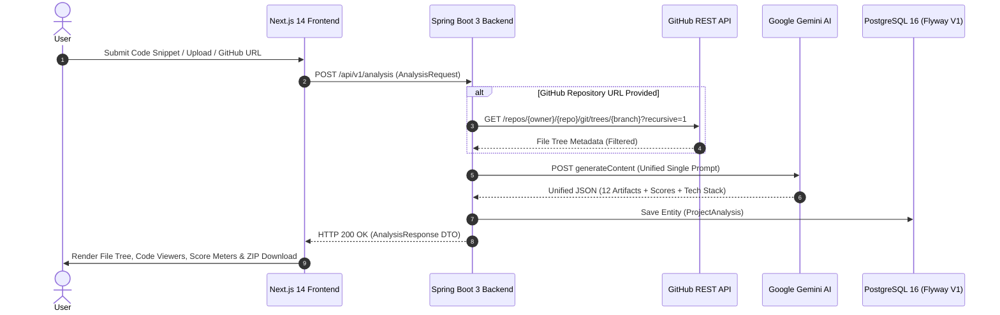
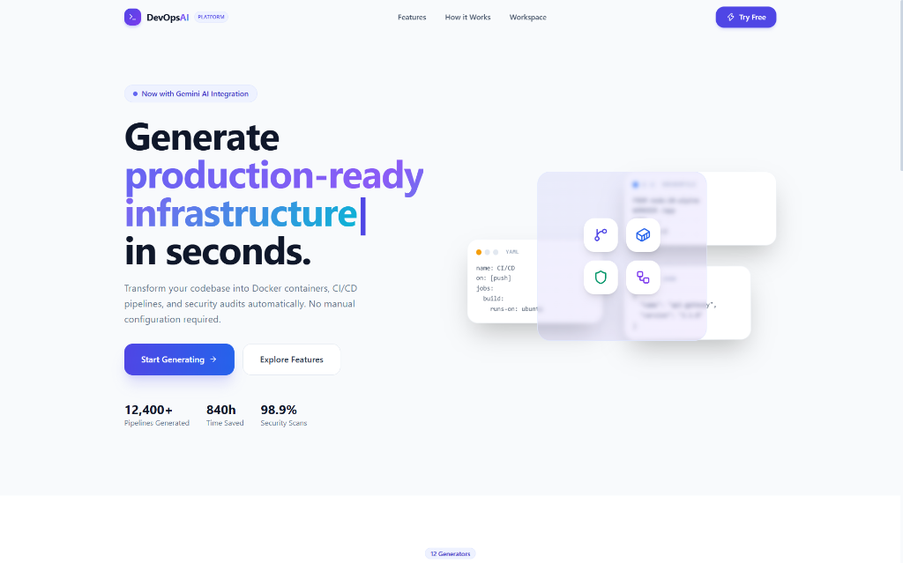
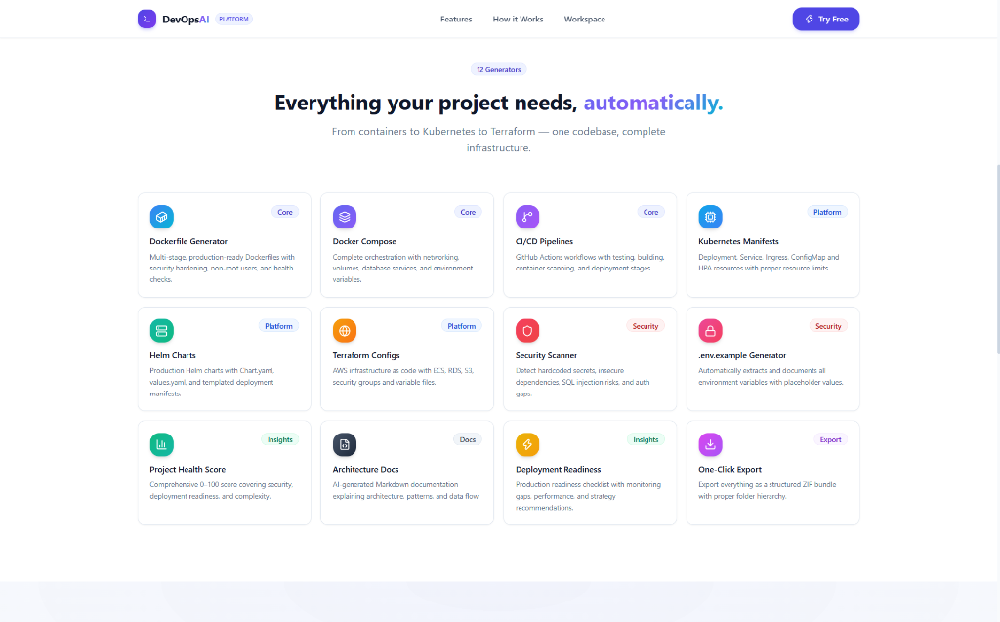
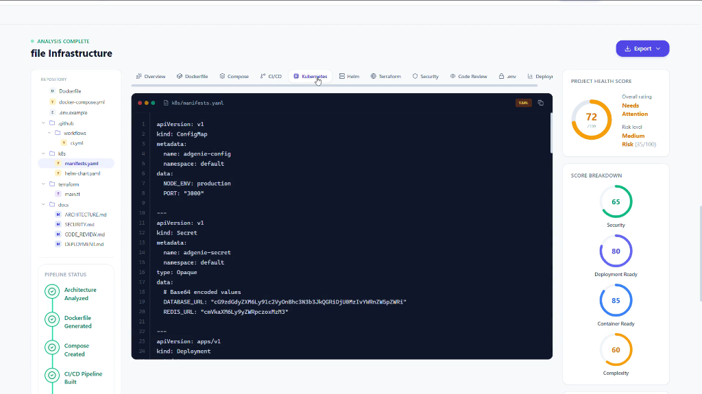
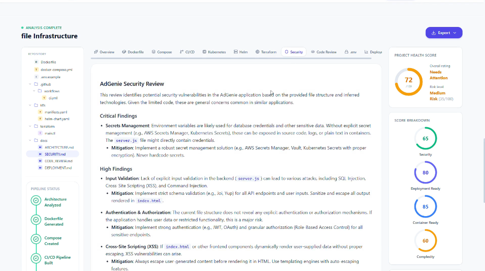

# 🚀 DevOpsAI Platform — AI DevOps Assistant

> **An AI-powered DevOps infrastructure generator & automated static code analysis platform** that turns any codebase into production-ready Dockerfiles, Kubernetes manifests, Terraform configs, GitHub Actions CI/CD pipelines, Helm charts, security audits, and more — in seconds.


---

## 🎥 Live Demo

📹 **Project Walkthrough (1 min 30 sec)**

https://drive.google.com/file/d/1SVy8shQxEdl5-cUGS9U3uJmkA_4H1TXR/view?usp=sharing

### Demo Timeline

| Time | Feature |
|-------|---------|
| 0:00–0:08 | Platform overview & supported DevOps generators |
| 0:08–0:17 | GitHub repository analysis |
| 0:18–0:51 | Live AI infrastructure generation |
| 0:52–1:07 | Docker, Compose, Kubernetes, Helm & Terraform |
| 1:08–1:15 | Automated security audit |
| 1:16–1:23 | Deployment readiness report |
| 1:24–1:30 | Health scoring & ZIP export |

---

## ✨ Features

Provide your source code (paste code, upload files, or provide a GitHub repository URL) and DevOpsAI generates **12 production-ready DevOps artifacts** in a single pass:

| Artifact | Description |
|---|---|
| 🐳 **Dockerfile** | Multi-stage build, non-root user setup, `HEALTHCHECK`, `EXPOSE` directives |
| 🐙 **Docker Compose** | Full multi-container orchestration with DB, Redis, networks, volumes |
| ⚡ **GitHub Actions CI/CD** | Test → Docker Build & Push → Trivy Security Scan → Deploy workflow |
| ☸️ **Kubernetes Manifests** | Deployment, Service, Ingress (TLS), HPA, ConfigMap in raw YAML |
| ⛵ **Helm Chart** | Chart.yaml + values.yaml + templates/deployment.yaml |
| 🌍 **Terraform Starter** | AWS ECS/EKS/EC2, VPC, RDS, S3 infrastructure as code (HCL) |
| 🔐 **Security Audit** | Categorized security risks (Secrets, SQL injection, Auth gaps, Validation) |
| 📋 **Code Review** | Static code quality analysis, performance smells, refactoring advice |
| 🔑 **.env.example** | Complete environment variable template with inline comments |
| 📊 **Deployment Report** | Production readiness checklist, monitoring strategy, container hardening |
| 🏗️ **Architecture Docs** | Comprehensive system architecture & technology breakdown |
| 💯 **Health & Risk Scores** | Calculated ratings (0–100) for security, readiness, and complexity |

---

## 🏗️ System Architecture

### Architecture Sequence Diagram



> 📌 A complete architectural walkthrough is included in the demo video above.

### Repository Project Structure

```
ai-devops-assistant/
├── docker-compose.yml              # Multi-container orchestration (Postgres, Backend, Frontend)
├── .env.example                    # Global environment variables template
├── start-backend.bat               # Windows startup script
├── docs/                           # Documentation and screenshots
│   └── screenshots/                # Application UI screenshots
├── devops-assistant-backend/       # Spring Boot 3 Java 17 REST API
│   ├── Dockerfile                  # Multi-stage Java build
│   └── src/main/resources/
│       └── db/migration/
│           └── V1__init_schema.sql  # Flyway database schema migration
│   └── src/main/java/com/devops/assistant/
│       ├── config/                 # CORS & Gemini Beans
│       ├── controller/             # REST Endpoints (AnalysisController, HealthController)
│       ├── dto/                    # AnalysisRequest, AnalysisResponse, ErrorResponse DTOs
│       ├── exception/              # GlobalExceptionHandler (@RestControllerAdvice)
│       ├── model/                  # ProjectAnalysis JPA Entity
│       ├── repository/             # ProjectAnalysisRepository (Pageable)
│       └── service/                # DevOpsGeneratorService, GeminiApiService, GithubService
└── devops-assistant-frontend/      # Next.js 14 Web Application
    ├── Dockerfile                  # Multi-stage Node 20 runner
    └── src/
        ├── app/                    # App Router (page.tsx, layout.tsx)
        ├── components/             # React components (FileTree, CodeViewer, ScoreMeter, etc.)
        ├── lib/                    # API client & JSZip export handlers
        └── types/                  # TypeScript interface definitions
```

---

## 🛠️ Tech Stack

### Backend
| Technology | Version | Purpose |
|---|---|---|
| Spring Boot | 3.2.3 | REST API Web framework |
| Java | 17 | Core runtime language |
| Google Gemini API | 1.5/2.5 Flash | LLM generative engine |
| PostgreSQL | 16 | Execution history database |
| Spring Data JPA | 3.2 | Database ORM |
| Jackson | 2.15 | JSON parsing |
| JUnit 5 / MockMvc | 5.x | Automated test suite |

### Frontend
| Technology | Version | Purpose |
|---|---|---|
| Next.js | 14.2.5 | React web framework |
| React | 18.3.1 | UI library |
| TypeScript | 5.6.2 | Type safety |
| Tailwind CSS | 3.4.4 | Utility-first styling |
| Framer Motion | 12.43 | UI micro-animations |
| JSZip | 3.10.1 | Client-side ZIP export |
| Lucide React | 1.28 | Modern icon system |

---

## ⚡ Unified LLM Prompt Engineering & Resilience

- **Single-Pass Prompting:** Rather than issuing 12 separate requests, `DevOpsGeneratorService` sends a single structured JSON prompt to Gemini. Using a single structured prompt significantly reduces the number of LLM API requests compared to generating each artifact independently.
- **Exponential Backoff Retry:** `GeminiApiService` handles transient HTTP `429 Too Many Requests` and HTTP `503` errors by automatically retrying up to 4 times with exponential backoff delays (2s → 4s → 8s).
- **GitHub REST API Integration:** When a GitHub URL is provided, `GithubService` queries `api.github.com` for tree metadata to feed rich repository structure into the LLM context.

---

## 📷 Screenshots

### Landing Page


### Infrastructure Generator


### Generated Kubernetes


### Security Dashboard


---

## ⭐ Engineering Highlights

- AI-powered DevOps artifact generation from source code and GitHub repositories
- Spring Boot 3 REST API with layered architecture
- Next.js 14 frontend using App Router and TypeScript
- Flyway database migrations for reproducible schema management
- PostgreSQL persistence with Spring Data JPA
- Docker Compose deployment for frontend, backend, and database
- GitHub REST API integration for repository analysis
- Global exception handling with standardized JSON responses
- Reactive WebClient integration with retry strategy
- Automated testing using JUnit 5 and MockMvc
- Health monitoring with Spring Boot Actuator

---

## 🚀 Quick Start

### 1. Clone the repository
```bash
git clone https://github.com/mohamad-shafeez/ai-devops-assistant.git
cd ai-devops-assistant
```

### 2. Set Environment Variables
Copy `.env.example` to `.env` and insert your Gemini API key:
```bash
cp .env.example .env
# Edit .env and set GEMINI_API_KEY=your_key_here
```

### 3. Option A — Run via Docker Compose (Recommended)
Spin up PostgreSQL, Spring Boot backend, and Next.js frontend with one command:
```bash
docker-compose up --build
```
- Frontend: `http://localhost:3000`
- Backend API: `http://localhost:8080`
- Health Endpoint: `http://localhost:8080/api/health`

### 4. Option B — Run Locally for Development

#### Start Backend:
```bash
# Set Gemini API Key
set GEMINI_API_KEY=your_key_here  # Windows
export GEMINI_API_KEY=your_key_here # Linux/Mac

# Start PostgreSQL via Docker Compose
docker-compose up -d postgres

# Launch Spring Boot
cd devops-assistant-backend
mvn spring-boot:run
```

#### Start Frontend:
```bash
cd devops-assistant-frontend
npm install
npm run dev
```

---

## ✅ Verification

Backend automated tests:

```bash
mvn clean test
```

Current status:
- ✔ Controller Tests
- ✔ Service Tests
- ✔ Validation Tests
- ✔ Build Successful

Tests Passed: 4/4

---

## 📡 API Reference

### `POST /api/v1/analysis`
Analyzes code or repository structure and generates 12 DevOps infrastructure artifacts.

**Request:**
```json
{
  "projectName": "ecommerce-api",
  "codeSnippet": "{\n  \"name\": \"ecommerce-api\",\n  \"dependencies\": { \"express\": \"^4.18.0\" }\n}",
  "repositoryUrl": "https://github.com/expressjs/express",
  "branch": "main"
}
```

**Response (200 OK):**
```json
{
  "projectName": "ecommerce-api",
  "summary": "...",
  "architectureDocs": "...",
  "dockerfile": "FROM node:20-alpine...",
  "dockerCompose": "version: '3.8'...",
  "githubActions": "name: CI...",
  "kubernetes": "apiVersion: apps/v1...",
  "helmChart": "apiVersion: v2...",
  "terraform": "provider \"aws\"...",
  "securityReview": "...",
  "codeReview": "...",
  "envExample": "...",
  "deploymentReport": "...",
  "detectedLanguages": ["JavaScript", "TypeScript"],
  "detectedFramework": "Express.js",
  "detectedDatabase": "PostgreSQL",
  "healthScore": 82,
  "securityScore": 75,
  "deploymentReadiness": 88,
  "containerReadiness": 90,
  "complexity": 35,
  "riskScore": 20,
  "suggestions": ["Configure rate limiting", "Add non-root container execution"]
}
```

### `GET /api/v1/analysis/history`
Returns all execution analysis records saved in PostgreSQL database.

### `GET /api/health`
Returns HTTP 200 `"OK"` for container health probes.

---

## 🚧 Roadmap

- OAuth GitHub authentication
- Repository diff analysis
- Azure & GCP Terraform generation
- GitLab CI support
- Docker image vulnerability scanning
- Multi-LLM provider selection
- Deployment cost estimation

---

## 📄 License

MIT License — see [LICENSE](LICENSE) for details.

---

<div align="center">
  <strong>Built by Mohamad Shafeez · Powered by Gemini AI</strong><br/>
  <em>Production-Ready Full-Stack AI DevOps Assistant</em>
</div>
